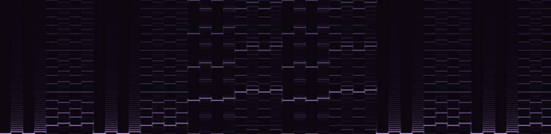

# bytebeat-jit

De la musique avec **une seule ligne de calcul**, compilée **en code machine x86-64 à la volée**.

Le *bytebeat* (viznut, 2011) : on évalue une formule de `t`, le numéro de l'échantillon, 8000 fois par seconde, on garde l'octet du bas, et on l'envoie à la carte son. `t*(42&t>>10)` fait déjà une mélodie qui se répète et évolue.

Ce programme lit la formule, construit son arbre syntaxique, et l'exécute avec **trois moteurs** écrits de zéro :

| Moteur | Principe | Vitesse (`t*5&(t>>7)\|t*3&(t*4>>10)`) |
|---|---|---|
| arbre | parcours récursif de l'arbre à chaque échantillon | 19 M échantillons/s |
| pile | compilation en *bytecode* pour une petite machine à pile | 21 M échantillons/s |
| **jit** | compilation en instructions x86-64, écrites octet par octet en mémoire puis exécutées | **490 M échantillons/s** |

Le JIT va 15 à 30 fois plus vite que les deux autres, soit ~60 000 fois le temps réel.




*Spectrogrammes de deux formules (faits avec [spectrogramme-secret](https://github.com/glime32/spectrogramme-secret)). On voit la mélodie de la première, et la structure qui se répète.*

## Utilisation

```sh
make
./bytebeat "t*(42&t>>10)" --jouer                 # écouter (aplay, pw-play ou paplay)
./bytebeat "t*(42&t>>10)" -o son.wav -d 60        # une minute en WAV
./bytebeat "t*(42&t>>10)" | aplay -f U8           # octets bruts sur la sortie standard
./bytebeat "t*(42&t>>10)" --code                  # bytecode, code machine et désassemblage
./bytebeat "t*(42&t>>10)" --bench                 # les trois moteurs face à face
./bytebeat --fuzz 3000                            # 3000 formules au hasard : les moteurs sont-ils d'accord ?
```

D'autres formules dans [`formules.txt`](formules.txt). Le langage : `t`, des nombres (`42`, `0xFF`), et les opérateurs du C avec leurs priorités : `+ - * / % & | ^ << >> ~ ! < <= > >= == != && || ?:`.

## Ce que fait le JIT

```
$ ./bytebeat "t*(42&t>>10)" --code
code x86-64 (22 octets) :
   0:  89 f8              mov    eax,edi        ; eax = t
   2:  b9 0a 00 00 00     mov    ecx,0xa
   7:  d3 f8              sar    eax,cl         ; t >> 10
   9:  b9 2a 00 00 00     mov    ecx,0x2a
   e:  21 c8              and    eax,ecx        ; & 42
  10:  89 f9              mov    ecx,edi
  12:  0f af c1           imul   eax,ecx        ; * t
  15:  c3                 ret
```

1. **Analyse.** Un lexeur découpe le texte, puis un analyseur par *precedence climbing* construit l'arbre en respectant les priorités du C (`t*(42&t>>10)` : `>>` avant `&`, parenthèses avant `*`).
2. **Pliage des constantes.** Tout sous-arbre sans `t` est calculé une fois pour toutes (`3*4+t` → `12+t`), et un `?:` à condition constante perd sa branche morte.
3. **Génération de code.** `t` arrive dans le registre `edi` (convention d'appel System V), le résultat repart dans `eax`. Pour `a OP b`, on calcule `b`, on le met de côté (`push`), on calcule `a`, on récupère `b` dans `ecx` (`pop`) et on émet `op eax, ecx`. Quand `b` est une constante ou `t`, pas besoin de la pile ; pour un opérateur commutatif, on échange les opérandes si ça l'évite.
4. **Sauts.** `?:`, `&&` et `||` deviennent des sauts conditionnels (`jz`, `jmp`). Leur destination n'est pas encore connue quand on les écrit : on laisse 4 octets vides et on les remplit une fois la cible générée.
5. **Exécution.** Le code est écrit dans une page obtenue par `mmap`, passée en lecture + exécution par `mprotect` (jamais écriture et exécution en même temps), puis appelée comme une fonction C `int32_t f(int32_t t)`.

**Pièges.** `idiv` fait planter le processeur (`SIGFPE`) sur une division par 0 *et* sur `INT_MIN / -1`. Le code généré teste les deux cas avant de diviser. Les décalages sont pris modulo 32 (comme le fait le processeur), `>>` garde le signe, et tout calcul déborde en boucle sur 32 bits : les trois moteurs ont exactement la même sémantique.

**Test par formules au hasard (`--fuzz`).** Un générateur écrit des formules aléatoires (avec des valeurs pièges : 0, −1, 31, 32, 2147483647...). Chacune passe dans l'arbre, la pile, le JIT et l'arbre plié, pour 400 valeurs de `t` : les quatre résultats doivent être identiques. 3000 formules, 1,2 million de comparaisons, aucune différence.

Le JIT ne sait écrire que du x86-64 ; ailleurs (ARM...), le programme utilise la machine à pile.
